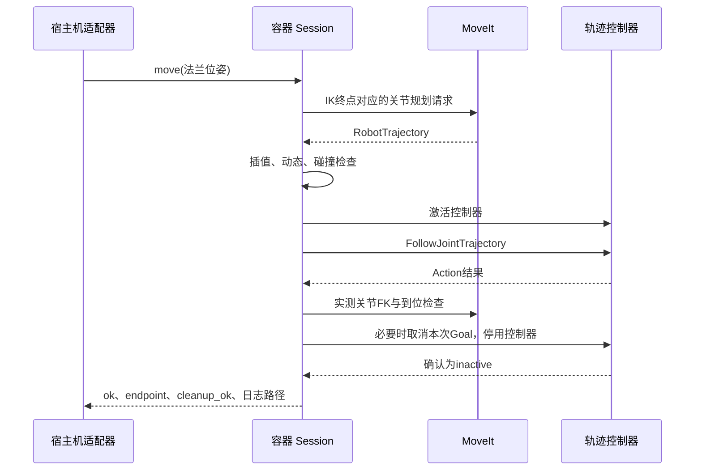

# Franka FR3：ROS 2 / MoveIt 2 实现与接口文档

整理日期：2026-10-17。依据本机现有源码、部署配置及历史说明整理。

本文描述你已经实现的 FR3 控制链路，包含独立 ROS 工作区和当前 Agent 接入层。此次整理只读取文件，没有启动容器、查询机器人或发送运动指令。文中的本机配置值是文件快照，不表示本轮完成了真机验收。

## 1. 之前的方案是什么

你采用了“宿主机 Python 业务层 + Docker 内 ROS 2 运动层”的结构：

```text
宿主机：Agent / 技能 / RGB-D 感知 / 抓取推理
  └─ hardware.runtime / LegacyPoseAdapter
       └─ hardware.fr3.FrankaMoveItArm
            └─ docker compose exec：发送 worker 源码和 JSON 请求
                 └─ hardware/fr3_worker.py（在容器内执行）
                      └─ /project/scripts/real_ptp.py：Session
                           ├─ 获取实测关节状态、Franka 状态
                           ├─ Pinocchio 多初值 IK 与候选筛选
                           ├─ 安装桌面和附着工具碰撞模型
                           ├─ MoveIt /plan_kinematic_path
                           │    └─ OMPL RRTConnect → TOTG → Ruckig
                           ├─ 审查控制器实际插值轨迹
                           └─ /fr3_arm_controller/follow_joint_trajectory
                                └─ C++ JointTrajectoryController
                                     └─ franka_hardware → libfranka → FCI → FR3
```

这是阻塞式、单段、末端位姿 PTP：输入法兰目标，选择 IK 关节解，规划一条关节空间轨迹，执行一次，到位检查后退出控制。中途允许绕行，也不要求沿途保持固定末端姿态。

“PTP”是这里的运动语义；实际规划器是 OMPL RRTConnect，没有使用 Pilz PTP pipeline。当前主链路直接调用 MoveIt 规划服务，并直接向轨迹控制器发送 Action，没有经由 MoveIt 的 ExecuteTrajectory Action 执行。

### 1.1 两个工作目录

| 目录 | 职责 |
| --- | --- |
| `/home/seur/data/wpy/armcode_agent` | 已部署 ROS / MoveIt 工作区：Docker、launch、控制器、IK、规划执行、碰撞检查、日志 |
| `/home/seur/data/wpy/armcode-agent (1)/armcode-agent` | 当前 Python Agent：业务、感知、抓取、坐标转换、机械臂和夹爪适配 |
| 容器 `/project` | 第一个目录的挂载点；源码只读，`logs/` 单独可写 |
| 容器 `/opt/ros/humble` | ROS 2 安装 |
| 容器 `/opt/fr3_ws` | 编译后的 Franka 基础工作区 |
| 容器 `/opt/fr3_no_recovery` | 真机镜像中的 franka_hardware 覆盖层 |

这两个宿主机目录不是同一个项目。当前 Python 仓库本身不包含完整 ROS 驱动和 MoveIt 部署文件，也不负责自动启动它们。

## 2. 软件版本与容器部署

### 2.1 版本依据

外部工作区 `sources.lock.json` 固定了以下源码：

| 组件 | 记录版本 | Git revision |
| --- | --- | --- |
| ROS 2 | Humble | 基础镜像 `ros:humble-ros-base` 使用 Dockerfile 中的 digest |
| MoveIt 2 | Humble 环境中的依赖 | 当前锁文件未单独固定 MoveIt Debian 包版本 |
| franka_ros2 | 2.7.1，humble | `3b50164eabbe2d461baca007bbbbe03c024387bd` |
| franka_description | 2.8.1 | `02afaae282d4a8e10d7d2f781b23b3515c303ce5` |
| libfranka | 0.20.4 | `95b406f47c97cedfbe426c04d8fb7f83a9885e1c` |

外部 README 记录目标为 Franka FR3、Robot System 5.9.1、FCI 地址 `172.16.0.2`。这些是原部署记录，本轮未读取机器人固件信息。不要直接把 Panda 的关节名、模型或其他版本驱动套到这套部署中。

### 2.2 镜像和服务

| 服务/镜像 | 网络与 ROS 域 | 用途 |
| --- | --- | --- |
| `real` / `armcode-fr3:real` | host 网络；`ROS_DOMAIN_ID=84`；`ROS_LOCALHOST_ONLY=1` | 真机状态、MoveIt、effort 控制器 |
| `fake` / `armcode-fr3:humble` | 无外部网络；ROS 域 83 | GenericSystem 假硬件验证 |
| `diagnostics` / 基础镜像 | host 网络 | 被动 libfranka 状态读取工具 |
| 独立 RViz preview 容器 | 无外部网络；ROS 域 86 | 保存轨迹回放 |

`real` 具备 `SYS_NICE`、`rtprio=99`、`memlock=-1`。控制器管理器配置 `update_rate=1000`、线程优先级 98。配置目标为 1 kHz，并不等于当前机器已经通过实时性或 FCI 丢包实测。

宿主机 Python 无需 source ROS 环境。worker 经真机入口脚本依次 source：

```bash
source /opt/ros/humble/setup.bash
source /opt/fr3_ws/install/setup.bash
source /opt/fr3_no_recovery/install/setup.bash
```

### 2.3 原来的构建与启动步骤

以下命令应在外部 ROS 工作区执行：

```bash
cd /home/seur/data/wpy/armcode_agent

# 首次部署或重建基础环境：拉取锁定源码并构建基础镜像。
bash scripts/fr3.sh build

# 基于基础镜像重建真机 franka_hardware 覆盖层。
bash scripts/real.sh build

# 启动真机栈，保持此终端打开；将连接 FCI。
bash scripts/real.sh start
```

已有可用镜像时直接启动，无需重复构建。`real` 的构建使用 `network: none`，依赖已准备好的基础镜像和本地源码。基础镜像部分 apt/rosdep 依赖没有完整版本锁定，未来重建不保证逐字节一致。

### 2.4 为什么真机有单独镜像

`Dockerfile.real` 只在构建副本中对 `franka_hardware/src/robot.cpp` 打补丁，移除五种控制接口启动时的自动清错/重试代码，再重新编译驱动。原 `vendor/` 源码不被改写。

真机 launch 检查 `FR3_NO_AUTOMATIC_RECOVERY=1`，客户端也检查该变量。其目的是保留启动控制失败的原始结果，避免捕获异常后自动恢复并再次启动。上游显式恢复入口仍保留，但本项目启动与运动脚本不调用。

## 3. ROS 节点、模型和控制器

### 3.1 Launch 实现

`launch/fr3_real.launch.py` 调用 `fr3_common.make_launch(mock=False, inactive_arm=True)`，启动：

| 节点/组件 | 功能 |
| --- | --- |
| `robot_state_publisher` | 发布 URDF 对应的 TF，并提供 `robot_description` 参数 |
| `ros2_control_node` | 装载 Franka 硬件接口及控制器，退出时关闭该 launch |
| `joint_state_broadcaster` | 发布关节位置、速度 |
| `franka_robot_state_broadcaster` | 发布 Franka 模式、错误和完整机器人状态 |
| `fr3_arm_controller` | 关节轨迹执行；真机启动时为 inactive |
| `move_group` | 规划、FK、状态有效性、场景管理 |
| `rviz2` | 可选；默认 `use_rviz=false` |

URDF 使用 `robot_type=fr3`、`hand=false`、`ee_id=none`，真机设置 `use_fake_hardware=false`。SRDF 同样关闭原生 Franka 手。外接 Robotiq 由附着碰撞包围盒表示，不作为原生 Franka 手指关节控制。

MoveIt planning group 为 `fr3_arm`，关节为 `fr3_joint1` 至 `fr3_joint7`。MoveIt 中虽然配置了 `MoveItSimpleControllerManager` 与 FollowJointTrajectory 映射，但设置 `moveit_manage_controllers=false`；当前 Session 自己负责控制器生命周期。

### 3.2 真机轨迹控制器

配置来源：外部 `config/real_controllers.yaml`。

```yaml
controller_manager:
  ros__parameters:
    update_rate: 1000
    thread_priority: 98
    fr3_arm_controller:
      type: joint_trajectory_controller/JointTrajectoryController

fr3_arm_controller:
  ros__parameters:
    joints: [fr3_joint1, fr3_joint2, fr3_joint3, fr3_joint4,
             fr3_joint5, fr3_joint6, fr3_joint7]
    command_interfaces: [effort]
    state_interfaces: [position, velocity]
    open_loop_control: false
    allow_partial_joints_goal: false
    state_publish_rate: 50.0
    action_monitor_rate: 20.0
```

各关节 PID 中 `i=0`、`i_clamp=1`，P/D 分别为：

| 关节 | P | D |
| --- | --- | --- |
| 1、2、3、4 | 600 | 30 |
| 5 | 250 | 10 |
| 6 | 150 | 10 |
| 7 | 50 | 5 |

业务层发送的是关节位置、速度、加速度轨迹；effort 接口控制器通过配置的 PID 将跟踪误差转换为 effort 命令。高频轨迹执行在 C++ 控制器和驱动内完成，Python 负责规划、监测与调度。这一接口语义与 [Humble JointTrajectoryController 官方说明](https://control.ros.org/humble/doc/ros2_controllers/joint_trajectory_controller/doc/userdoc.html)一致。

假硬件使用 100 Hz、position command interface，不能据此验证真机 effort 跟踪、工具动力学或实时性能。

## 4. 一次运动的完整实现过程

### 4.1 宿主机到容器的调用

1. `FrankaMoveItArm` 生成 32 位十六进制 `request_id`。
2. 将操作、目标、速度、容差、超时等序列化为 JSON。
3. 读取本仓库 `hardware/fr3_worker.py` 的源码，经参数传入容器。
4. `docker compose exec -T` 在指定 `real` 或 `fake` 服务中运行 Python。
5. worker 从 `/project/scripts` 导入外部工作区的 `real_ptp.Session`。
6. 收集日志事件并输出 `ARM_AGENT_RESULT=<JSON>`，宿主机解析结果。

等价命令结构为：

```text
docker compose -f <workspace>/compose.yaml exec -T real
  /bin/bash /fr3-real-entrypoint.sh
  python3 -u -c <worker源码> <JSON请求>
```

fake 使用 `/fr3-entrypoint.sh`。Python 仓库无需额外挂载到容器中；worker 每次随请求发送，规划代码来自现有 `/project/scripts`。

### 4.2 只读位姿：`show_pose()`

通过 `robot_description` 验证真实/假硬件类型，读取新关节反馈，再调用 `/compute_fk`，返回基座系下的模型法兰位姿。此操作不安装规划场景、不激活轨迹控制器、不发送运动。

这里的“当前末端”是实测关节值经过模型 FK 得到的 `fr3_link8`，不是独立测量的指尖位置，也不是直接返回 Desk 的 TCP 位姿。

### 4.3 规划：`prepare()`

依次执行：

1. **验证硬件模式**：URDF 中真实插件必须为 `franka_hardware/FrankaHardwareInterface`，fake 必须为 `mock_components/GenericSystem`，混用就退出。
2. **验证控制器归属**：`fr3_arm_controller` 必须存在且为 inactive；其他 active 控制器不能占用 command interfaces。
3. **安装并回读碰撞场景**：桌面、工具包围盒、允许碰撞矩阵必须符合配置。
4. **读取新状态**：等待开始读取之后到达的新关节与 Franka 状态；反馈超过 0.5 s 视为过期。真机需无 current_errors，规划开始时为 Idle，关节速度不超过 0.01 rad/s。
5. **生成法兰目标**：绝对六维位姿，或当前法兰位置加基座系位移。相对位移保持目标姿态，但沿途姿态仍可变化。
6. **求解多组 IK**：Pinocchio 阻尼局部 IK，从当前关节和扰动初值搜索冗余解；按关节变化大小排序。
7. **复核 IK**：按当前模式检查奇点指标、关节限制；调用 FK 验证误差不超过 0.5 mm / 0.005 rad，再检查碰撞。
8. **调用 MoveIt**：向 `/plan_kinematic_path` 发送关节目标约束，最多尝试策略允许数量的 IK 终点。
9. **审查返回轨迹**：检查数据、起点、插值动态峰值、关节范围、工具桌面间隙及采样碰撞。
10. **复核规划终点 FK**：需满足 0.5 mm / 0.005 rad 的内部目标误差要求，保存轨迹及摘要。

目标若已经达到且没有需切换的指定关节解，当前实现抛出 `Already at the requested pose; no motion needed`，不会返回一次成功的空运动。

MoveIt 请求核心参数：

```text
group_name                      fr3_arm
planner_id                      RRTConnectkConfigDefault
start_state                     当前实测关节，RobotState.is_diff=true
num_planning_attempts            3
allowed_planning_time            5.0 s（每次规划请求）
max_velocity_scaling_factor      speed
max_acceleration_scaling_factor  speed
goal_constraints                七个 JointConstraint，目标角容差 ±0.00005 rad
```

使用 `RobotState.is_diff=true` 是为了更新关节状态时保留场景中的附着工具几何。

### 4.4 时间参数化和实际插值审查

规划 pipeline 配置 OMPL、TOTG 时间参数化和 Ruckig 平滑。Humble adapter 列表把 Ruckig 放最前面，使其在包装调用的末尾执行。

客户端还独立审查 JTC 使用的五次插值，不能只看 MoveIt waypoint 是否合规：

| 检查 | 当前行为 |
| --- | --- |
| 轨迹内容 | 七关节完整，至少两点；位置、速度、加速度齐全且有限 |
| 时间 | 从 t=0 开始，时间戳严格递增 |
| 起点 | 首点与读取起点的最大关节差不超过 0.002 rad |
| 边界速度 | 首末速度绝对值不超过 `1e-5` rad/s |
| 时长 | 必要时整体放慢，使总时长至少 3 s |
| 速度上限 | `0.5 × speed` rad/s |
| 加速度上限 | `1.0 × speed` rad/s² |
| jerk 上限 | 5 rad/s³ |
| 动态采样 | 每段每关节取 101 个点估计峰值，必要时统一减速并再次检查 |
| 几何/碰撞采样 | 每段至少 10 个子区间，采样间隔不大于 20 ms |

这些是工程采样检查，不能表述为连续时间数学证明。速度比例是规划及检查的缩放参数，不是 TCP 速度，增大一倍也不保证耗时恰好减半。

### 4.5 执行：`execute()`

1. 再次回读并验证桌面和工具场景。
2. 再次读取状态；任何关节偏离规划起点超过 0.002 rad 就拒绝旧轨迹。
3. 标记本客户端已尝试激活控制器，通过 STRICT switch 激活 `fr3_arm_controller`。
4. 激活后再次读取状态，复核起点漂移。
5. 发送一个 FollowJointTrajectory Goal。
6. 等待 Action 结果，持续检查反馈时效、机器人模式和错误。
7. 读取新关节状态并做 FK，检查法兰误差和停止状态。
8. 无论正常完成、失败还是中断，进入 cleanup。

Action Goal 显式携带：每个关节位置容差 `0.02 rad`、速度容差 `0.01 rad/s`、到位额外时间 `2 s`。路径位置容差由控制器配置提供，为 `0.05 rad`。

成功必须同时满足：Action 状态 `STATUS_SUCCEEDED`、控制器 `SUCCESSFUL`、笛卡尔到位误差合格、关节已停止、适用的终点筛选通过，以及控制器清理成功。到位接近不能覆盖 aborted/cancelled 结果。

### 4.6 退出控制：`cleanup()`



`control_cleanup.stop_owned_control()` 使用独立节点和 executor，避免原状态订阅 executor 异常后无法清理。只取消本次非零 goal ID；不发送“取消所有目标”的空 ID。只在本客户端尝试过激活后承担停用责任，随后再次查询并确认 inactive。

worker 使用 `/tmp/armcode-agent-fr3.lock` 的非阻塞排他锁，减少同一容器内 Agent 请求并发；该锁不覆盖绕过 worker 的独立客户端。并发控制还依赖启动前控制器归属检查，接口没有排队语义。

宿主机遇到中断、超时或 `motion_guard` 异常，会依据 request ID 对应的 PID 文件，并验证 `/proc/<pid>/cmdline` 后发送 SIGINT。worker 进入清理后关闭计时器并忽略重复 SIGINT/SIGTERM，尽量让取消和停用完成。强杀、宿主机故障等情况仍可能留下无法确认的状态。

## 5. ROS 2 接口清单

以下是当前 Session 和 Workcell 实际使用的端点，完整消息字段以已安装的 Humble 接口定义为准。

### 5.1 Topic

| Topic | 类型 | 使用方式 |
| --- | --- | --- |
| `/joint_states` | `sensor_msgs/msg/JointState` | 七关节位置和速度；客户端使用 BEST_EFFORT、depth=1 |
| `/franka_robot_state_broadcaster/robot_state` | `franka_msgs/msg/FrankaRobotState` | 仅真机订阅；监测模式、错误并保存状态 |

广播器配置 `convenience_publish_rate=30`；Session 对收到的完整 Franka 状态按约 0.1 s 间隔写日志，模式/错误变化也触发记录。日志写入频率不是底层控制频率。

### 5.2 Service

| Service | 类型 | 请求与响应要点 |
| --- | --- | --- |
| `/robot_state_publisher/get_parameters` | `rcl_interfaces/srv/GetParameters` | `names=[robot_description]`；读取 URDF 并验证驱动类型 |
| `/controller_manager/list_controllers` | `controller_manager_msgs/srv/ListControllers` | 读取 state、claimed_interfaces |
| `/controller_manager/switch_controller` | `controller_manager_msgs/srv/SwitchController` | 激活/停用本次控制器，STRICT、activate_asap、5 s 切换超时 |
| `/compute_fk` | `moveit_msgs/srv/GetPositionFK` | `header.frame_id=fr3_link0`、`fk_link_names=[fr3_link8]`、七关节 RobotState |
| `/plan_kinematic_path` | `moveit_msgs/srv/GetMotionPlan` | 输入 MotionPlanRequest，返回 MotionPlanResponse 与 RobotTrajectory |
| `/get_planning_scene` | `moveit_msgs/srv/GetPlanningScene` | 获取 ACM、世界几何和附着物，安装前后及执行前核对 |
| `/apply_planning_scene` | `moveit_msgs/srv/ApplyPlanningScene` | 用 diff 安装桌面、工具、ACM；要求 success=true |
| `/check_state_validity` | `moveit_msgs/srv/GetStateValidity` | 检查起点、IK 终点和插值采样；失败记录 contact pairs |

IK 在本地 Pinocchio 进程池中计算，当前主链路没有调用 `/compute_ik`。上述 FK 与规划请求均要求 `MoveItErrorCodes.SUCCESS`。

### 5.3 Action

| Action/取消服务 | 类型 | 用途 |
| --- | --- | --- |
| `/fr3_arm_controller/follow_joint_trajectory` | `control_msgs/action/FollowJointTrajectory` | 执行审查后的完整七关节轨迹 |
| `/fr3_arm_controller/follow_joint_trajectory/_action/cancel_goal` | `action_msgs/srv/CancelGoal` | 取消本客户端尚未完成的具体 goal |

发送的 `trajectory` 为 `trajectory_msgs/msg/JointTrajectory`：`joint_names`、`points[].positions`、`velocities`、`accelerations`、`time_from_start`。Action 反馈机制由 ROS 提供；当前执行监测主要依靠 joint_states、FrankaRobotState 以及 Action 最终结果。

## 6. 宿主机 Python API

源码：[hardware/fr3.py](../hardware/fr3.py)、[hardware/interfaces.py](../hardware/interfaces.py)。

### 6.1 位姿类型与约定

```python
Pose6D(x, y, z, rx, ry, rz,
       base_frame="fr3_link0", target_link="fr3_link8")
```

| 项目 | 约定 |
| --- | --- |
| 位置 | 米；法兰原点在基座系中的位置 |
| 姿态 | 固定轴 XYZ RPY，弧度；`R = Rz(rz) @ Ry(ry) @ Rx(rx)` |
| 接受坐标系 | 仅 `fr3_link0 → fr3_link8` |
| 输入检查 | 六个有限数；坐标系不符直接拒绝 |
| `.values` | `[x, y, z, rx, ry, rz]` |

RPY 不是旋转向量，不是度数。内部姿态误差用四元数旋转角计算，避免直接相减欧拉角。

### 6.2 机械臂对象

```python
FrankaMoveItArm(config: ArmConfig, *, stack=None,
                execution_enabled=False, motion_guard=None)
```

构造对象不连接 ROS 或机器人。`stack` 可覆盖配置中的 real/fake；`execution_enabled` 决定是否允许运动；可选 `motion_guard()` 在运动前及宿主机等待过程中被调用，异常会触发本次请求取消。

| API | 返回 | 语义 |
| --- | --- | --- |
| `get_pose()` | `Pose6D` | 新关节反馈对应的模型法兰 FK；完整结果保存在 last_result |
| `plan_pose(pose)` | `dict` | 从当前状态规划并检查；不执行运动 |
| `move_pose(pose)` | `dict` | 从当前状态重新规划、执行一段、到位检查、退出控制 |
| `set_speed_scaling(value)` | `None` | 设置 `(0,1]` 有限比例，影响后续请求 |
| `plan_grasps(candidates)` | `dict` | 批量候选 IK 筛选与规划，不执行；只允许 endpoint 模式 |
| `move_joint_goal(pose, goal_joints)` | `dict` | 指定七关节终点，重新规划；仍检查 FK 与 pose 一致 |
| `home()` | `dict` | 执行配置的 home_pose；未配置就报错 |
| `close()` | `None` | 当前为空操作；每个阻塞请求已经清理自己的 ROS 会话 |
| `last_result` | `dict` 或 `None` | 最近成功解析的 worker 结果，包含日志路径和错误证据 |

`plan_pose()` 不生成可供下一次 `move_pose()` 回放的计划句柄。再次 move 时会重新规划，路径可能不同。固定关节终点也只固定终点，不能固定整条路径。

### 6.3 读取与规划示例

```python
from hardware.config import load_config
from hardware.fr3 import FrankaMoveItArm, MotionError
from hardware.interfaces import Pose6D

cfg = load_config()
arm = FrankaMoveItArm(cfg.arm, execution_enabled=False)
try:
    current = arm.get_pose()
    target = Pose6D(current.x, current.y, current.z + 0.005,
                    current.rx, current.ry, current.rz)
    result = arm.plan_pose(target)
    print(result["plan"])
    print(result["host_log_path"])
except MotionError as error:
    print(error.result)
finally:
    arm.close()
```

示例会读取所选栈的真实或 fake 状态并规划。执行需要显式构造 `execution_enabled=True`，再调用 `move_pose(target)`；该调用会重新规划并执行真实动作（当 stack=real）。

### 6.4 旧技能接口兼容

`hardware.runtime.LegacyPoseAdapter` 只适配现有技能用到的少量接口：

```python
get_position(is_radian=True) -> (0, [x_mm, y_mm, z_mm, rx, ry, rz])
set_position(x=..., y=..., z=..., roll=..., pitch=..., yaw=...,
             speed=None, mvacc=None, wait=True) -> 0
disconnect() -> None
```

`set_position()` 先将前三项 mm 转为 m，再调用 FR3 的阻塞 PTP。只支持 `wait=True`，旧 `speed/mvacc` 会被忽略并提示，实际由 FR3 speed_scaling 控制。返回 0 的前提是控制器、到位和 cleanup 全部成功。

兼容对象通过 `context.xarm` 注入，但坐标语义已经是 FR3 基座到法兰；它不是完整 xArm SDK。旧字段 `best_grasp_xarm_mmrad` 也仍可能存储 FR3 法兰目标，不能按字段名称套用旧机器人坐标变换。

## 7. worker JSON 协议

这是宿主机与容器子进程间的内部协议，不是 HTTP API，也没有自定义 ROS `.srv/.action`。

### 7.1 公共请求字段

| 字段 | 类型 | 含义 |
| --- | --- | --- |
| `request_id` | string | 32 位小写十六进制，追踪、PID 归属与结果匹配 |
| `operation` | string | `pose` / `plan` / `move` / `plan_grasps` |
| `stack` | string | `real` / `fake` |
| `timeout_s` | number | worker 总工作期限；进入 cleanup 后取消该计时器 |
| `speed_scaling` | number | `(0,1]` |
| `position_tolerance_m` | number | 正数，实际末端到位位置容差 |
| `orientation_tolerance_rad` | number | `(0,π]`，实际末端到位姿态容差 |
| `singularity_screening` | string | `endpoint` / `advisory` |
| `pose` | number[6] | plan/move 所需的法兰 XYZ/RPY |
| `goal_joints` | number[7] | 可选，固定关节终点 |
| `grasp_candidates` | object[] | plan_grasps 的候选列表 |

示例（仅用于解释协议，不是本轮运动记录）：

```json
{
  "request_id": "0123456789abcdef0123456789abcdef",
  "operation": "plan",
  "stack": "real",
  "timeout_s": 180,
  "speed_scaling": 0.2,
  "position_tolerance_m": 0.005,
  "orientation_tolerance_rad": 0.03490658503988659,
  "singularity_screening": "endpoint",
  "pose": [0.31, 0.0, 0.59, 3.14159265359, 0.0, -0.785398163397]
}
```

上例数值仅演示格式，不代表适合当前真机的目标。Python 接口不提供相对 offset 字段；相对控制可自行计算绝对目标，或使用外部 `real.sh plan/move DX DY DZ`。

### 7.2 返回字段

worker 最后一行输出 `ARM_AGENT_RESULT=` 前缀加 JSON，其余 stdout 可以包含 ROS 日志。

| 字段 | 出现条件/内容 |
| --- | --- |
| `ok`、`cleanup_ok` | 所有结果；工作是否成功、ROS 会话与自有控制是否清理成功 |
| `request_id`、`operation`、`stack` | 请求关联信息 |
| `error` | 出错时的异常文字；当前没有统一数字错误码 |
| `log_path` | 通常为 `/project/logs/agent/<request_id>.jsonl` |
| `host_log_path` | 由宿主机补充的映射路径 |
| `current_pose` | pose 操作：坐标系、单位、六维位姿、xyzw 四元数 |
| `plan` | 规划完成：时长、采样峰值、终点关节、目标位姿、碰撞/奇点摘要等 |
| `action_result` | 执行获得结果后：status、controller_error_code、controller_error_string |
| `endpoint` | 实际到位检查可获得时：位置/姿态误差、速度、关节误差、奇点指标 |
| `grasp_selection` | 批量筛选成功：候选索引、关节终点、筛选数量、规划尝试和计时 |

宿主机验证子进程退出码、request ID、`ok` 和 `cleanup_ok`；任何失败均抛出 `MotionError`，异常的 `.result` 保留报告。即便动作到位，cleanup 失败也不算调用成功。

宿主机正常等待期限为 `request_timeout_s + 45 s`，取消后最多再等 40 s。ROS 普通 service 通常为 15 s 超时；新状态等待 10 s；Action 结果等待为轨迹时长加 10 s。总时长仍可能先受 worker 总期限限制。

### 7.3 批量抓取候选约定

每项至少包含：

```text
base_T_flange        有限、合法的 4×4 刚体变换
flange_xyz_rpy       对应的六维法兰位姿
score               有限且 > 0
jaw_symmetry_flipped 必须为 false
```

策略默认至多 32 个候选、每候选 32 个 IK 初值、至多 12 个 CPU worker、最多 5 次候选规划尝试。IK 进程不连接 ROS 或机器人；使用 spawn，避免 fork 活跃 DDS 进程。

选择时先按 score 降序，再按关节变化升序尝试。矩阵和 RPY 的形状、有限值等会被检查；两者必须由调用方保持一致，后续 pinned IK 的 FK/目标复核还会拒绝不一致终点。筛选成功时 `motion_command_sent=false`，执行需单独调用运动 API。

## 8. 碰撞场景、工具与奇点策略

### 8.1 当前工作台和工具模型

唯一工作台配置来源为外部 `config/workcell.json`，Agent 的几何筛选也读取此文件。

| 配置 | 当前文件值 |
| --- | --- |
| `base_frame` / `flange_link` | `fr3_link0` / `fr3_link8` |
| `table_z_m` | 0.0 |
| `table_clearance_m` | 0.0 |
| `tool_length_m` | 0.17 |
| `tool_max_width_m` | 0.10 |
| `tool_padding_m` | 0.005 |
| `straight_mount_confirmed` | true，沿法兰 +Z 直装 |
| `grasp_table_clearance_check` | false，Agent 候选预筛选开关 |

生成的附着 BOX 尺寸为 `0.11 × 0.11 × 0.175 m`，法兰系中心位于 `z=0.0875 m`，覆盖法兰 +Z 的 `[0,0.175] m`。

场景对象 ID：桌面 `fr3_workcell_table`，工具 `fr3_robotiq_envelope`。桌面是无限平面；ACM 仅允许安装基座 `fr3_link0` 接触桌面；工具 touch_links 为 `fr3_link7`、`fr3_link8`。

沿轨迹既调用 MoveIt 状态有效性检查，也计算工具盒角点最低高度，避免整个工具落到平面下方却不与平面相交的漏检。

关闭 `grasp_table_clearance_check` 只影响上层抓取候选预筛选，不能关闭这里的 MoveIt 场景或轨迹桌面检查。当前自动安装的环境是机器人、桌面和工具；不能据此认为已自动建模药盒、盘子、相机、线缆、被抓物体及所有周围障碍物。

### 8.2 奇点筛选的两个模式

外部 `config/singularity.json` 默认：特征长度 0.3 m，最小 scaled sigma 0.18，最大 condition 20，最小 elbow-locked sigma 0.12，肩部 `abs(q2)` 最小 0.15 rad，关节限位裕量 0.07 rad。

| 入口/模式 | 当前行为 |
| --- | --- |
| `ArmConfig` 默认、独立控制脚本 | endpoint：候选和终点需通过工程奇点/关节裕量筛选 |
| `build_hardware(..., agent=True)` | 强制覆盖为 advisory，只记录这些额外裕量指标 |
| `plan_grasps()` | 只支持 endpoint；advisory 请求被拒绝 |
| 轨迹中途奇点指标 | 作为诊断记录，不要求全路径都满足终点工程阈值 |

advisory 仍检查真实关节范围、碰撞、动态约束和到位状态。上述阈值是本项目工程策略，不是 Franka Desk 内部未公开告警阈值；通过筛选不代表保证没有黄灯。

## 9. 手眼标定与 TCP 接口

### 9.1 坐标变换链

矩阵采用列向量约定：`p_parent = T_parent_child @ p_child`，平移单位为米。腕部相机的抓取目标转换为：

```text
T_base_camera = T_base_flange(capture) @ T_flange_camera

T_base_tcp_goal = T_base_camera @ T_camera_grasp @ T_grasp_tcp

T_base_flange_goal = T_base_tcp_goal @ inverse(T_flange_tcp)
```

`T_grasp_tcp` 表示模型抓取坐标轴到物理 TCP 的对齐；`T_flange_tcp` 表示实际工具 TCP 相对法兰的变换。碰撞盒长度不能替代 TCP。

当前本机标定文件记录：腕部相机为 eye-in-hand、外参父系 `fr3_link8`、子系 `wrist_color_optical_frame`；TCP 沿法兰 +Z 约 0.16 m，轴与法兰平行。工具碰撞长度 0.17 m、含 padding 长度 0.175 m，是另外两个量。

当前模型对齐矩阵的旋转部分为：

```text
T_grasp_tcp.rotation = [[0, 0, 1],
                       [1, 0, 0],
                       [0, 1, 0]]
```

该配置同时记录 `translation_is_approximate=true`、`alignment_status=nominal_preview`、`alignment_verified=false`。文件中的 backend 标签仍为 gsnet，上层当前实际选择 AnyGrasp；这些元数据不能被当成两种后端均已完成精密轴标定的证明。

`CalibratedTransforms.require_ready()` 只检查所需矩阵是否存在，不认证真实精度，也不以 alignment_verified=false 阻止计算。历史顶部注释中的“完整 Agent 禁用”与后续集成代码不一致，应以实际代码行为和这些精度元数据分别判断。

### 9.2 变换 API

源码：[hardware/transforms.py](../hardware/transforms.py)。

```python
transforms.require_ready()
transforms.camera_point_to_base(
    point, camera, current_flange,
    device_serial=..., optical_frame=...,
) -> list[float]

transforms.camera_grasp_to_flange_pose(
    camera_grasp, camera, current_flange,
    device_serial=..., optical_frame=...,
) -> Pose6D

transforms.tcp_to_flange_pose(base_tcp) -> Pose6D
```

`current_flange` 必须是拍摄时的位姿，而不是推理完成后的当前位姿。接口验证相机序列号与 optical frame，未标定相机不能当作单位矩阵处理。目前全局相机主要用于 RGB 观察，不能直接用于这条基座系抓取几何转换。

### 9.3 拍摄位姿绑定

`hardware.agent_camera.CalibratedCamera.capture_wrist()` 在采集前后读取真实法兰，等待新 RGB-D 帧。位移大于 1 mm 或旋转大于 0.01 rad 就丢弃；还检查同帧对齐点云与颜色内参等条件。

图像、点云、capture.json、拍摄前后位姿、序列号和标定摘要被保存到独立 observation 目录。实时拍摄拒绝使用 fake FK，防止把真实图片配到假关节状态。

## 10. 配置入口与实际生效值

主配置：[config/hardware/fr3.yaml](../config/hardware/fr3.yaml)。发布模板：[fr3.example.yaml](../config/hardware/fr3.example.yaml)。

| 字段 | ArmConfig/独立脚本默认 | 当前本机 YAML |
| --- | --- | --- |
| `arm.workspace` | `/home/seur/data/wpy/armcode_agent` | 同左 |
| `arm.stack` | real | real |
| `arm.speed_scaling` | 0.10 | 0.20 |
| `arm.position_tolerance_m` | 0.003 | 0.005 |
| `arm.orientation_tolerance_rad` | π/180，即 1° | 0.03490658503988659，即 2° |
| `arm.request_timeout_s` | 180 | 180 |
| `arm.singularity_screening` | endpoint | YAML 未设置，继承默认；Agent 装配覆盖为 advisory |
| `arm.home_pose` | null | null |
| `arm.place_flange_z_m` | null | 0.30 |
| `perception.grasp_backend` | PerceptionSettings 默认 gsnet | anygrasp |

`real.sh` 直接调用独立脚本，不读取 Agent 硬件 YAML，所以默认仍是 0.10、3 mm、1°。Agent 的 `--arm-speed` 显式参数覆盖 YAML 速度比例；不是旧 xArm 的 `--move_speed/--move_acc`。

YAML 的 `calibration_file`、`gripper.contact_close_file`、`perception.reference_config` 相对硬件 YAML 所在目录解析。workspace 要求绝对路径。未知配置键会报错，避免拼错后静默采用默认值。

`place_flange_z_m=0.30` 指最终释放时法兰的基座 Z，应用于 TCP 转法兰之后，不是 TCP 高度，也不是桌面间隙。`FrankaMoveItArm.home()` 在 home_pose=null 时拒绝执行；完整 Agent 可以另行使用本轮起始实际法兰姿态作为任务内 home，二者不同。

## 11. 命令行使用

### 11.1 当前 Python 仓库

```bash
cd '/home/seur/data/wpy/armcode-agent (1)/armcode-agent'

# 只读取配置，不连接设备。
python -m hardware.cli config

# 从已经运行的真机栈读取法兰模型位姿。
python -m hardware.cli arm pose --stack real

# X Y Z RX RY RZ 必须替换为已确定的数字，单位 m / rad。
python -m hardware.cli arm plan X Y Z RX RY RZ --stack real

# 下列命令执行真实运动。
python -m hardware.cli arm move X Y Z RX RY RZ --stack real --execute
```

需要非默认硬件配置时，`--config` 位于子命令之前：

```bash
python -m hardware.cli --config /absolute/path/to/fr3.yaml arm pose --stack real
```

CLI 返回码：成功 0、一般失败 1、KeyboardInterrupt 130；缺少必要参数等由 argparse 报错。`arm move/home` 要求 `--execute`，只有 plan 不执行。

### 11.2 外部 ROS 工作区

```bash
cd /home/seur/data/wpy/armcode_agent

bash scripts/real.sh status
bash scripts/real.sh pose

# 相对位移，基座 Z +5 mm；默认 plan 也是该位移。
bash scripts/real.sh plan 0 0 0.005

# 绝对法兰位姿，仅规划。
bash scripts/real.sh plan-pose X Y Z RX RY RZ \
  --speed 0.20 --position-tolerance 0.005 \
  --orientation-tolerance 0.03490658503988659

# 以下两类命令会执行真实运动。
bash scripts/real.sh move 0 0 0.005
bash scripts/real.sh move-pose X Y Z RX RY RZ

bash scripts/real.sh logs
bash scripts/real.sh stop
```

绝对位姿脚本还允许 `--max-translation`、`--max-rotation`、`--max-joint-delta`，默认不启用这些额外变化上限。当前宿主机 worker 没有暴露这些参数，会传 None；它们不能替代关节、碰撞与动态检查。

### 11.3 完整 Agent

先由外部工作区启动 ROS real 栈，再在当前仓库运行：

```bash
# 观察、推理、几何计算；不执行机械臂/夹爪动作。
bash run_fr3_agent.sh --arm-speed 0.20 --visualize_selected_grasp

# 开启真实动作执行。
bash run_fr3_agent.sh --arm-speed 0.20 --visualize_selected_grasp --execute_robot
```

省略 `--execute_robot` 仍可能采集相机、加载模型、读取真实法兰，因此不是纯离线模式。

典型抓取流程为观察 → 生成抓取 → 转法兰目标 → 预抓取 → 接近抓取 → 夹爪闭合 → 读取实际法兰 → 抬升 → 搬运/放置。各移动段使用现有 PTP 重规划，不能把“预抓取到抓取”理解为已实现 Cartesian 直线轨迹。

## 12. Robotiq 与机械臂控制的边界

外接 Robotiq 2F-85 由宿主机 USB/RS-485 Modbus RTU 驱动，不通过这里的原生 `franka_gripper` Action 控制。当前配置为 115200 baud、slave ID 9，固定 by-id 串口；原生 Franka hand 在模型中关闭。

`hardware.runtime.Hardware.attach()` 将 arm、gripper、transforms 注入 context。执行会话可以持续监测夹爪通信，将健康检查绑定为机械臂 `motion_guard`；夹爪失联或故障会触发当前机械臂请求取消。

配置 contact_close_file 后使用 `AgentContactGripper`，其接触/电流控制与轨迹控制是两条链。闭合正常完成不等于确认夹住物体；不能把原始电流换称为指尖牛顿力。详细夹爪接口见 [gripper_contact.txt](gripper_contact.txt)。

## 13. 日志、排错与验证

### 13.1 日志位置

| 内容 | 宿主机路径 |
| --- | --- |
| worker 每请求日志 | `/home/seur/data/wpy/armcode_agent/logs/agent/<request_id>.jsonl` |
| 独立 real_ptp 运动日志 | 外部工作区 `logs/real/ptp-*.jsonl` |
| real.sh 启动日志 | 外部工作区 `logs/real/start-*.log` |
| ROS 日志 | 外部工作区 `logs/ros-real/` |
| Agent 抓取数据 | 当前仓库 `runs/agent_anygrasp/` 或 `runs/agent_gsnet/` |
| 拍摄位姿证据 | 对应采集目录的 `observations/<id>/capture.json` |

关键事件包括 `current_pose`、`workcell`、`start`、`parallel_ik`、`ik_candidates`、`plan_candidate_rejected`、`plan`、`controller_switch`、`execute_requested`、`action_result`、`endpoint`、`failure`、`cancel_response`、`control_stopped`。`plan` 事件包含完整序列化轨迹，worker 返回的 plan 只是摘要。

### 13.2 常见故障

| 信息/表现 | 含义与定位 |
| --- | --- |
| No worker result | 服务未运行、Python 导入失败、进程异常等；查看附带 stdout 和容器日志 |
| Arm controller must start inactive | 已处于 active 或缺失；检查上一请求与 cleanup 日志，不等同于不可达 |
| Another active controller owns command interfaces | 控制资源已被占用，当前请求拒绝执行 |
| Robot hardware does not match requested mode | real/fake URDF 与所选模式不一致 |
| No fresh complete robot state / feedback is stale | 反馈不完整或过期，检查 broadcaster、驱动和 ROS 环境 |
| No collision-free IK candidate | IK、终点裕量或桌面/工具碰撞筛选未通过 |
| No validated collision-free trajectory | MoveIt 或后续插值/动态/碰撞审查未通过，没有下发轨迹 |
| Robot moved after planning | 起点已变化，拒绝使用旧轨迹 |
| Final flange pose outside tolerance | 控制器结果不足以证明笛卡尔到位，FK 复核失败 |
| Controller cleanup incomplete | 控制停止未能确认，整次调用失败；检查 Desk、日志及控制器状态 |
| Camera serial/frame mismatch | 图像来源或 optical frame 与标定绑定不一致 |

项目没有自动清错、自动重试或失败后继续下一段的底层策略。上一请求已结束而控制器仍 active 时，历史操作流程是保留日志、停止 real 栈，再启动并确认 inactive；应先查明前次失败原因。

### 13.3 断网假硬件验证

旧默认 fake launch 会激活轨迹控制器，不能直接用于要求 inactive 起点的新接口。使用本仓库 override：

```bash
docker compose \
  -f /home/seur/data/wpy/armcode_agent/compose.yaml \
  -f '/home/seur/data/wpy/armcode-agent (1)/armcode-agent/config/hardware/fake.override.yaml' \
  up -d --no-build fake
```

在当前 Python 仓库内执行：

```bash
python -m unittest discover -s tests -p test_fr3_hardware.py -v
python tests/fr3_mock_smoke.py
```

mock smoke 覆盖 fake 位姿、规划、模拟执行、碰撞拒绝、取消与控制器停用；结果写到 `runs/hardware_validation/fr3_mock_smoke.json`。这仍不是动力学仿真或真机精度验收。单元测试中的部分测试读取本机配置，迁移到没有 fr3.yaml 的新机器时需要先配置测试环境。

外部工作区另有 `test_pose_math.py`、`test_endpoint_acceptance.py`、`test_trajectory_limits.py`、`test_workcell.py`、`test_singularity.py`、`test_cleanup_ownership.py` 及取消/故障注入集成脚本。

### 13.4 保存轨迹回放

在外部工作区的图形桌面终端运行：

```bash
bash scripts/preview.sh logs/real/ptp-YYYYMMDD-HHMMSS-ffffff.jsonl
# worker 日志也可显式传入：
bash scripts/preview.sh logs/agent/REQUEST_ID.jsonl
```

preview 容器无网络，仅回放保存的轨迹、桌面和工具；不发送机器人动作。回放中关闭 RViz 不会自动启动机械臂运动。后续 move 仍重新规划，不能据此认为执行的一定是刚预览的同一条轨迹。

## 14. 历史记录与当前实现的差异

| 容易混淆的记录 | 当前核对结果 |
| --- | --- |
| “项目只有 xArm，缺少 Franka 接口” | 部分早期 AnyPlace 报告的阶段结论；当前 hardware/ 已有 FR3 接口，ROS 部署在独立目录 |
| “完整 Agent 尚未接入” | fr3_hardware.txt 的早期迁移阶段记录；后续 Agent 和 runtime 已接入 |
| 默认速度 0.10 / 到位 3 mm、1° | 类与独立脚本默认；当前本机 Agent YAML 是 0.20 / 5 mm、2° |
| TCP 0.18 m 或其他旧值 | 当前标定文件约 0.16 m；应与工具碰撞长度 0.17 m 区分 |
| 桌面额外余量 0.01 m 或 0.005 m | 当前 workcell.json 为 0.0 m，padding 仍为 0.005 m |
| 奇点是终点硬门槛 | 独立/批量入口可为 endpoint；完整 Agent 装配强制 advisory |
| fake 等于真实机器人动力学 | 当前 fake 是 GenericSystem、position 控制，与真机 effort 栈不同 |
| plan 后 move 执行同一条轨迹 | 当前 move 会重新规划，没有公开的已保存轨迹执行接口 |
| 标定文件顶部注释代表运行限制 | 部分注释已过时；require_ready 只检查矩阵可计算性，精度标记仍未完成 |

历史文档中的通过项与用户报告是已有记录；本文没有重复运行这些验收，也没有将其升级为本轮实测结论。

## 15. 源码索引

### 当前 Python 仓库

| 文件 | 重点 |
| --- | --- |
| [hardware/fr3.py](../hardware/fr3.py) | Python API、Docker 传输、结果校验、取消 |
| [hardware/fr3_worker.py](../hardware/fr3_worker.py) | 容器 worker、锁、超时、Session 事件转结果 |
| [hardware/interfaces.py](../hardware/interfaces.py) | Pose6D 与 Arm/Transforms 接口 |
| [hardware/config.py](../hardware/config.py) | 数据类默认值、YAML 解析和校验 |
| [hardware/cli.py](../hardware/cli.py) | 机械臂/夹爪/标定命令行 |
| [hardware/runtime.py](../hardware/runtime.py) | 设备装配、Agent advisory 覆盖、旧技能兼容 |
| [hardware/transforms.py](../hardware/transforms.py) | 相机、抓取、TCP、法兰矩阵转换 |
| [hardware/agent_camera.py](../hardware/agent_camera.py) | 图像与拍摄位姿绑定 |
| [docs/fr3_hardware.txt](fr3_hardware.txt) | 分阶段硬件迁移记录 |
| [docs/fr3_agent.txt](fr3_agent.txt) | Agent 集成和现场命令记录 |

### 独立 ROS 工作区

以下文件均位于 `/home/seur/data/wpy/armcode_agent/`，不包含在当前 Python 仓库发布包中。

| 相对该目录的路径 | 重点 |
| --- | --- |
| `compose.yaml`、`Dockerfile`、`Dockerfile.real`、`sources.lock.json` | 部署、源码版本和驱动覆盖 |
| `launch/fr3_common.py`、`fr3_real.launch.py` | 模型、MoveIt pipeline、节点和 inactive 启动 |
| `config/real_controllers.yaml`、`fake_controllers.yaml` | 真机 effort 与 fake position 控制 |
| `config/workcell.json`、`singularity.json` | 场景尺寸和工程筛选策略 |
| `scripts/real_ptp.py` | 状态、规划、轨迹检查、执行、到位 |
| `scripts/workcell.py` | 场景安装、回读、插值碰撞审查 |
| `scripts/singularity.py`、`fast_ik.py` | Pinocchio IK 和奇点指标 |
| `scripts/grasp_screen.py` | 多抓取候选筛选与规划 |
| `scripts/control_cleanup.py` | 独立 executor 取消与停用 |
| `scripts/real.sh`、`fr3.sh`、`preview.sh` | 启动、构建、操作和回放 |

上游接口语义参考 [Humble JointTrajectoryController 文档](https://control.ros.org/humble/doc/ros2_controllers/joint_trajectory_controller/doc/userdoc.html)与 [MoveIt Humble API 文档](https://moveit.picknik.ai/humble/doc/api/api.html)；本项目的具体端点、默认值与调用顺序以以上本机源码为准。
