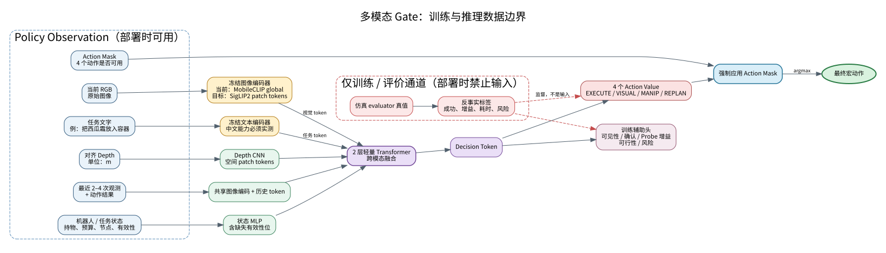

# RGB-D + 任务文字多模态 Gate（阶段一）

新增的 `gate_learning/` 不修改旧 Gate 的公式、阈值、网络或默认模式。它建立了独立的
多模态训练与推理入口：原始 RGB、米制对齐深度、任务文字、最近观测、机器人/任务状态
和 `action_mask` 共同进入 Gate；上游 detector/OCR/VLM confidence 不再是必要输入。



汇报文件包括 SVG 矢量图、高分辨率 PNG 和可编辑的 Graphviz DOT 源文件，均位于
`docs/multimodal_gate_architecture.*`。

## 模型与数据边界

当前能离线运行的冻结编码器是项目已有 MobileCLIP-B。图像与文字各输出一个 512 维
全局 token；深度 CNN 产生 4×4 空间 token；状态具有显式缺失有效性位；最近最多四个
图像 embedding 作为历史 token。两层轻量 Transformer 融合这些 token，输出四个
action value，以及可见性、目标确认、Probe 增益、可行性和风险辅助头。选择动作前强制
应用 `action_mask`。

融合网络也接受 `[B,N,D]` 图像 patch token。后续换成本地 SigLIP2 checkpoint 时不需
改变训练样本和动作头。SigLIP2 backend 默认 `local_files_only=true`，不会隐式下载。

状态向量固定为 17 维，只含动作历史、Probe 次数、进度与有效性、持物、buffer、任务
节点、时间预算和四个 action mask；不含 detector/OCR/VLM confidence。适配器和
manifest validator 会拒绝 evaluator state、场景类别、true blocker、body id 和
optimal action 等隐藏字段。未执行动作必须设置 `action_values_valid=0`，损失不会把未知
结果当作失败。

## 验证命令

```bash
conda run -n armcode_recognition_v2 python -m pytest -q tests/test_multimodal_gate.py

conda run -n armcode_recognition_v2 python -m gate_learning.cli smoke \
  --rgb runs/gate_sim/gate_action_videos/gate-sim-001004-E-e254a3dd/observations/obs_001_cam_0.png \
  --depth runs/gate_sim/gate_action_videos/gate-sim-001004-E-e254a3dd/observations/obs_001_depth.npy \
  --task '把燕麦盒放入紫色容器' \
  --second-task '把饮料罐放入紫色容器' \
  --output runs/gate_learning/smoke_report.json
```

上面路径应替换为实际 episode 中对应的 RGB/Depth。smoke action head 随机初始化，只
验证输入、维度、掩码和时延，输出动作没有任务意义。

本机 CPU 的一次实测结果（场景 E、192×144 RGB-D）如下。计时包含一次图像和两条文本
编码，未做严格 benchmark；仅用于确认复杂度量级。

| 项目 | 原 23 维 MLP | 新多模态 Gate |
|---|---:|---:|
| 可训练参数 | 11,588 | 578,416 |
| 冻结编码器参数 | 0 | 149,776,641 |
| 核心输入 | 23 个人工标量 | RGB、Depth、任务文本、状态、历史 |
| 上游置信度特征依赖 | 是（VLM 字段可缺失） | 否 |
| 原 MLP CPU 前向 | 约 0.033 ms | 不适用 |
| 新冻结编码（1 图+2 文本） | 不适用 | 约 169 ms |
| 新融合头（2 次前向） | 不适用 | 约 6.4 ms |

两条中文任务文本的 MobileCLIP embedding 余弦相似度为 0.967，属于需要警惕的高相似度；
因此它目前只是本地可运行基线，不应直接作为中文任务最终编码器。

## 20 种子开发验收

`runs/gate_learning/counterfactual_20/` 使用 seeds 2300–2319，A–E 各四个场景。每个初始
快照枚举四个动作槽位，共 80 个槽位，其中 48 个可用动作进行了真实物理分支；所有分支
采用相同后续策略、五宏动作上限和环境时间预算。采集中掉落为 0，非预期物体扰动为 0。

16 个快照组用于训练、最后四个快照组用于验证；同一快照没有跨 split。80 epoch 仅用于
检查小数据闭环，并非正式超参数搜索：

| 方法 | 训练动作匹配 | 四样本留出集 |
|---|---:|---:|
| 新多模态 Gate | 13/16（81.25%） | 3/4（75%） |
| 只看 action mask：能执行则执行，否则先观察 | 不作为训练 | 2/4（50%） |
| legacy Gate | 不作为训练 | 0/4（0%） |

legacy 在这些样本中三次选择了不可用 REPLAN，另一次选择 VISUAL_PROBE；原因是当前仿真
没有 OCR/VLM 语义证据，不能把此结果解释为新模型已经优于真实系统 legacy。现有 23 维
learned MLP 也没有训练 checkpoint，无法进行同标签公平对比。留出集只有四个样本且场景
布局高度相似，75% 只能说明输入—采集—训练—checkpoint 链路有效，不能说明泛化成立。

完整原始结果：

- `runs/gate_learning/counterfactual_20/collection_report.json`
- `runs/gate_learning/counterfactual_20/counterfactual_manifest.jsonl`
- `runs/gate_learning/train_20/training_report.json`
- `runs/gate_learning/train_20/multimodal_gate.pt`（开发 checkpoint，禁止部署）

开发 checkpoint SHA-256：
`50d2900717921325cc2747084204a26bac895a3fcd880584bbd08c105c2393f1`。加载时还会核对
编码器 backend、特征维度和 checkpoint SHA-256，防止错误组合权重。当前采集实际监督了
action value、feasibility、probe gain 和 risk；visibility/target-confirmed 辅助头没有标签，
推理接口将其返回为 `value=null, valid=false`，不会把随机输出伪装成置信度。

训练分为冻结特征缓存与小头训练两步：

```bash
.venv-gate-sim/bin/python -m gate_learning.collect_sim \
  --seeds 5 --seed-start 2000 \
  --output-dir runs/gate_learning/counterfactual_dev

conda run -n armcode_recognition_v2 python -m gate_learning.cli cache \
  --manifest runs/gate_learning/counterfactual_dev/counterfactual_manifest.jsonl \
  --output-dir runs/gate_learning/cache

conda run -n armcode_recognition_v2 python -m gate_learning.cli train \
  --cache-index runs/gate_learning/cache/index.jsonl \
  --output-dir runs/gate_learning/train_v1 --device cuda:0
```

manifest 每行应包含 `sample_id`、`split_group`、`split`、`rgb`、`depth`、
`task_text`、17 维 `state_vector`、四维 `action_mask`、`action_values` 和
`action_values_valid`。同一快照产生的所有分支必须使用同一个 `split_group`。
第一版 action value 在失败时为 0；成功时等于完成任务后剩余的统一仿真时间预算比例。
它无需搜索奖励权重，同时能区分“直接成功”和“做了无必要 Probe 后成功”。掉落、扰动、
可见性变化和 primitive success 仍作为独立原始结果保存在采集报告中。

## 当前限制

本地 MobileCLIP-B 已能运行，但不同中文药品任务文本的区分能力需要重点评测。它只输出
全局视觉 embedding，不如 patch token 适合遮挡定位。当前只有 20 样本开发 checkpoint，
没有达到部署条件，也没有足量反事实标签；因此本阶段只证明工程管线可运行，不声称任务
成功率已经超过原 23 维 Gate。本轮只采集了 episode 初始决策点，历史 token 分支尚未
获得真实训练样本；48 个执行分支也没有风险正例，因此当前 risk 头不可用于安全判断。

实测环境为 Python 3.10.20、PyTorch 2.5.1+cu121、torchvision 0.20.1+cu121、
Transformers 5.5.4、timm 0.9.5、open-clip-torch 2.32.0、NumPy 2.2.6、Pillow
12.1.1。MobileCLIP 来自项目内 `dependencies/yoloe` commit
`40cd606cabdbe2b566d6f14a6b162c89206e9a1b`，权重 SHA-256 为
`670844f7a886dd6eff7a9285adfc53f3d3c889c03bfc8354010cb5c6bf27441a`。
