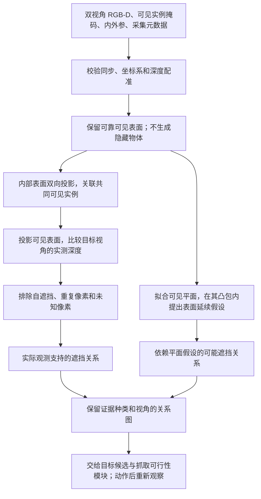

# RoboCasa365 中文药盒遮挡场景

在 RoboCasa365 官方 `Kitchen` 上新增 `OcclusionCounter`，使用官方厨房布局、
家具与 PandaOmron 机器人。自制药盒有真实表面中文纹理、独立碰撞体、质量和摩擦。
当前交付包括可交互场景、RGB-D 导出、几何验收，以及离线双视角遮挡证据推理。
自动身份识别、清障规划和机器人抓放策略尚未接入。没有导入或调用本项目的真机硬件服务。

## 当前阶段：先完成夹取搬移的 Agent

默认物体配置为 `graspable`，本阶段按“观察 → 遮挡推理 → 选择遮挡物 →
夹取并放到缓冲区 → 再观察 → 抓取目标”推进。推动、吸附和宽大物体操作不纳入
当前动作范围。这个闭环是后续实现目标，场景切换不是已实现的 Agent 清障。

| 物体 | 长 × 宽 × 高（cm） | 俯抓时跨越的短边（cm） |
| --- | --- | --- |
| 药盒 | 9 × 4.5 × 2.5 | 4.5 |
| 部分遮挡物 | 8 × 3 × 2.5 | 3 |
| 完全遮挡物 | 12 × 6 × 4 | 6 |

药盒和遮挡物一起调整尺寸，以保留部分／完全遮挡，同时控制俯抓夹持宽度。
按仿真 Panda 夹爪名义开口 8 cm、每侧预留 1 cm 做尺寸筛查，所有物体的水平短边
不超过 6 cm。`manifest.json` 中的 `top_grasp_size_screen` 记录尺寸、闭合轴和
开口预算；它只用于场景评价，不向推理算法提供隐藏物体真值。
尺寸合格不等于抓取成功：IK、接近空间、碰撞、稳定性和真实执行尚待验证；
真机夹爪需以实际工具能力为准，不能直接继承仿真名义开口。

旧的大尺寸配置保留为 `--object-profile legacy_wide`，用于复现历史结果。
两个配置使用独立输出目录，程序会拒绝在原目录中静默切换尺寸配置，以免破坏
已经导出的 XML、RGB-D 和评价数据的一致性。

## 安装与运行

在项目根目录运行。环境独立于现有 Agent 与 PyBullet 环境，需要 Python 3.11
（安装脚本通过 uv 准备）、OpenGL/EGL 和中文字体。Ubuntu 通常已有
`/usr/share/fonts/opentype/noto/NotoSansCJK-Bold.ttc`；也可以用 `--font` 指定字体。

```bash
bash scripts/setup_robocasa_scene.sh
bash run_robocasa_scene.sh render --all
.venv-robocasa/bin/python -m robocasa_occlusion.validation
```

安装脚本固定于 2026-10-17 获取的最新上游提交，避免之后更新导致测试场景改变：

| 组件 | 版本 / 提交 |
| --- | --- |
| RoboCasa365 | 1.0.1 / `a9e152e2eea16d342dac40e4577fb4c68b932854` |
| robosuite | 1.5.2 / `5ce6643f3092639d08f7b0f90ed1c6a84f50552c` |
| MuJoCo | 3.3.1，与 RoboCasa365 的依赖一致 |

此环境安装仿真、渲染依赖，没有安装用于学习的 LeRobot / Tianshou，因此不是完整的
训练环境。官方 robosuite 可能提示缺少可选 robot models、mink 或 mimicgen；
本场景使用的 PandaOmron 与默认控制器不依赖它们。
第三方源码、下载资产、虚拟环境和生成结果均在 Git 忽略目录中。
下载的四组官方资产按 `upstream.lock.json` 校验 SHA-256。若上游资产改变，安装程序
会报告不匹配，避免静默改变实验条件。

本机实测 EGL 设备 0 初始化失败，程序自动选用设备 1 的 Mesa llvmpipe 软件渲染。
RGB-D 导出已经成功，但该运行没有使用 RTX 4090 D 加速渲染。实际设备与渲染器记录
在 `manifest.json`；显式设置 `MUJOCO_EGL_DEVICE_ID` 时程序尊重该选择。

交互查看（需要桌面 DISPLAY）：

```bash
bash run_robocasa_scene.sh view --scenario label_occluded
```

- `1`：无遮挡；`2`：文字遮挡；`3`：完全遮挡。
- `C`：切换检查相机、俯视相机、全景相机、左侧固定相机、腕部相机。
- `F`：自由相机，可用 MuJoCo viewer 的鼠标控制观察。
- 状态切换重新初始化物体位置，**不是机器人执行了搬运**。

只渲染一个场景或更换随机种子：

```bash
bash run_robocasa_scene.sh render --scenario label_occluded --seed 1 --output-dir runs/robocasa_graspable_seed1
```

## 场景与观测

默认 layout 11、style 14，固定机器人和相机初始化，三个同尺寸、同配色的药盒
仅名称不同：布洛芬、维生素、复方片。名称只印在顶面；两侧没有泄漏身份的文字。
随机种子决定名称与位置的对应关系。同一个种子的三个遮挡条件保持相同身份布局。
蓝绿色区域用于停放遮挡物，紫色区域预留为目标放置区域；两者是可视区域标记，
不构成新的物理支撑面。

| 场景 | 初始化条件 |
| --- | --- |
| `clear` | 两个遮挡物都在缓冲区域，目标名称可见 |
| `label_occluded` | 小遮挡物放在目标顶面，遮住名称但保留部分盒体可见 |
| `fully_occluded` | 大遮挡物放在目标顶面，在检查/俯视相机中完全挡住目标 |

完全遮挡是针对指定观测相机的条件；从其他视角可能找到目标，这是后续主动感知
要研究的行为。场景导出同时保存多个相机供开发检查，后续主动视角策略应只接收
实际选取视角的图像，不能提前读取未访问视角。

当前配置输出默认位于 `runs/robocasa_graspable/`；
`legacy_wide` 默认仍使用 `runs/robocasa_occlusion/`：

```text
gallery.png                       三种初始条件预览
camera_comparison.png             左侧固定相机 / 腕部相机，同一场景对照
assets/                           PNG 包装、OBJ 标签网格、MJCF 物体
manifest.json                     版本、配置与评价信息（不作策略输入）
validation.json                   几何与物理验收结果
{scenario}/observation/
    {camera}_rgb.png              RGB，左上角图像原点
    {camera}_depth_m.npy           float32，相机光轴 Z 深度，单位米
    {camera}_camera.json           K、T_world_from_camera_optical
{scenario}/evaluation/
    metrics.json                  文字区域可见度、目标像素数、物体速度
    identity.json                 目标身份与实例映射真值
    {camera}_segmentation.npy      MuJoCo [object type, object id] 真值
    scene.xml                     编译前场景 XML，引用本机资产绝对路径
    physics_state.npz              qpos/qvel/time，仅用于离线检查
```

`observation/` 不含目标实例真值、实例分割或物体位置。场景类也移除了上游 Kitchen
默认加入的物体真值观测；机器人自身状态仍可从 `env.reset()` / `env.step()` 获得。
相机采用 OpenCV 光学坐标：X 向右、Y 向下、Z 向前。深度已经从 MuJoCo 深度缓冲
转换为米，RGB、深度、评价分割均一致翻转到左上角原点。

## 模仿真机的左侧固定相机

新增 `left_oblique` 相机，光心在机械臂安装底座坐标系的位置为
**(-0.25, +0.45, +0.89) m**。三个分量均相对机械臂底座，89 cm 不是离地高度。
在当前 PandaOmron 场景中，安装底座约离地 0.70 m，因此光心约离地 1.59 m。
坐标参考采用物理臂座 `robot0_link0`，不是 RoboCasa 停在 `(10,10,0)` 的
`robot0_base` XML 根节点，也不是台面中心或移动底盘原点。

“斜向下看”的默认实现是看向固定药盒操作区中心；它不跟踪目标物体。
当前默认注视点在臂座系约为 `(0.428, -0.091, 0.245) m`。
未提供真机相机内参和精确安装角度，因此垂直视场角暂设 60°、保持画面竖直方向
朝上，默认分辨率仍为 1280×960。这是按指定位置搭建的近似视角，不代表已经复现
真机镜头标定。相机在环境 reset 后按臂座位置放好，此后固定在世界坐标系，
不会随机器人运动或场景内药盒移动。

复现本次导出：

```bash
bash run_robocasa_scene.sh render --all \
  --object-profile graspable \
  --left-camera-position -0.25 0.45 0.89 \
  --output-dir runs/robocasa_graspable

.venv-robocasa/bin/python -m robocasa_occlusion.validation \
  runs/robocasa_graspable
```

交互查看：

```bash
bash run_robocasa_scene.sh view --scenario label_occluded \
  --camera left_oblique --output-dir runs/robocasa_graspable
```

历史 `runs/robocasa_left_camera` 保留大尺寸版本；查看它时显式添加
`--object-profile legacy_wide --output-dir runs/robocasa_left_camera`。

用 `--left-camera-lookat X Y Z` 指定臂座系注视点（米），
用 `--left-camera-fovy DEG` 调整垂直视场角。参数的默认值和坐标变换在
[`cameras.py`](cameras.py)，相机初始化在 [`environment.py`](environment.py)。

每个状态现在包含 `left_oblique_rgb.png`、`left_oblique_depth_m.npy` 和
`left_oblique_camera.json`。与腕部相机的对照见根目录 `camera_comparison.png`。
所有视角在同一个仿真状态下渲染，中间不执行物理步进；每个相机 JSON 保存：

- `camera_id`、共享的 `capture_group_id`、仿真时间戳和 RGB-D 对齐标记；
- 内参 `K`、`T_world_from_camera_optical`；
- 采集时的 `T_world_from_arm_base` 和 `T_arm_base_from_camera_optical`；
- 左侧相机另外保存配置位置、实际世界坐标、注视点和视场角假设。

仿真时间戳不是 Unix 时间，跨视角配对使用相同 `capture_group_id`。
这些几何信息可以用于后续投影检查，跨视角遮挡推理尚未接入。
仿真同时保存左侧 RGB-D，便于隔离验证几何；真机如果仅启用该相机 RGB，
不能将这份仿真深度当作真机已有输入。

当前 `graspable` 默认种子、1280×960 三种状态下，目标在两个视角的可见像素数
如下（分割真值仅用于评价）：

| 状态 | 左侧固定相机 | 腕部相机 |
| --- | --- | --- |
| 无遮挡 | 2761 | 8115 |
| 文字遮挡 | 1545 | 2564 |
| 检查视角完全遮挡 | 622 | 0 |

缩小后的完全遮挡物在检查／俯视／腕部相机中遮住目标全部像素，而左侧相机能看到
622 个盒体像素。这提供了跨视角可见性差异的测试样例，但不等于实际 perception
已经检测或识别出目标；零可见的单帧仍然不能创建目标节点。旧 `legacy_wide`
布局在左侧／腕部相机中都为零可见，保留用于后续困难场景。

本次尺寸、相机位置、朝向、同步导出及原遮挡条件通过 53 项产物检查。
物体配置、相机几何与场景集成测试命令为：

```bash
.venv-robocasa/bin/python -m pytest -q \
  tests/test_robocasa_assets.py tests/test_robocasa_cameras.py tests/test_robocasa_occlusion.py
```

## 验证范围

2026-10-17 实测默认种子的三场景均通过 26 项产物检查，新增的两项集成测试通过，
原项目 `scripts/check_core.py` 的 103 项检查通过。集成测试还检查了策略观测无物体
真值、三个药盒在无遮挡条件下均可见，以及恢复同一起始物理状态后重新初始化的
RGB 逐像素一致、深度在 1e-6 米容差内一致。

```bash
.venv-robocasa/bin/python -m pytest -q tests/test_robocasa_occlusion.py
```

验收程序用目标文字矩形的三维投影与分割归属测量可见比例，并检查：无遮挡时
文字区域可见、部分遮挡时文字隐藏但盒体可见、完全遮挡时目标像素为零；同时检查
RGB-D 有效和自由刚体已沉降。这些是评价真值，不能用于决定搬哪个物体。

文字几何可见不等于 OCR 已经识别成功。本阶段没有训练或评价 OCR，也没有宣称
机器人已完成清障或抓取。后续可以将 `observation/` 接入现有识别流水线，然后
逐步实现观察、搬移、抓取三个动作。

物体位置用 `set_scenario()` 初始化；该接口仅用于搭建测试条件，不应当作为策略
执行清障的捷径。`physics_state.npz` 也不是完整的 Agent 恢复快照，不包含控制器
内部状态和搜索记忆。

## 使用可见分割真值检查单帧关系推理

三种状态已经渲染后，可以直接运行，无须重启仿真或识别模型：

```bash
.venv-robocasa/bin/python -m robocasa_occlusion.probe_relations
```

可用 `--scene-dir` 指定已有场景导出目录，用 `--output-dir` 指定结果目录。
默认使用 `inspection` 相机，也支持 `--camera overhead`；每次只向算法提供选定
相机的单帧数据。脚本会读取保存的 XML 来解析 geom 与物体的归属，因此 XML
引用的本机资产路径需要有效。

这里明确使用 **可见实例分割真值** 替代分割器，以单独测试关系算法。输入节点
只来自实际渲染到图像里的物体像素，编号匿名化，不传目标身份、物体位姿、
隐藏区域轮廓或遮挡真值。完全不可见物体没有节点。核心算法只读取可见掩码和
深度；预测结束后，评价代码才用身份真值检查方向。

输入默认使用 `runs/robocasa_graspable/`，
输出默认位于 `runs/occlusion_relations/robocasa_graspable/`：

- 每个状态的 `observation/`：统一接口的 JSON 和 NPZ，可以用相同关系提取入口重跑。
- 每个状态的 `relations/`：`relations.json` 和 `relations_overlay.png`。
- `probe_validation.json`：三个状态的检查结果和证据状态统计。

当前默认保存场景的检查结果：

| 状态 | 可见实例数 | `possible_occludes` 边 | 检查内容 |
| --- | --- | --- | --- |
| 无遮挡 | 5 | 0 | 没有产生遮挡假设 |
| 文字遮挡、盒体仍可见 | 5 | 1 | 小遮挡物 → 目标药盒，方向正确 |
| 目标完全遮挡 | 4 | 0 | 不泄漏不可见目标，不凭空生成节点 |

小物体可见轮廓较薄时，关系模块使用互为最近距离的边界配对，避免把后景外轮廓
跨过可见细边，与前景重复配对，稀释真正的遮挡交界证据。像素距离、深度差和
方向一致性阈值保持不变；中间有可见背景间隙的近邻仍不能据此判成遮挡。

完全遮挡时没有目标关系边是当前输入下的预期结果，不表示没有隐藏目标。
这三项检查是固定场景的功能回归，不是准确率基准；当前随机种子仅改变药名布局。
泛化评估还需要独立改变几何布局、遮挡比例、视角、形状、深度噪声及分割误差，
并引入无遮挡近邻等负例。算法字段、阈值及限制见
[`perception_v2/README.md`](../perception_v2/README.md#遮挡推理第二步单帧关系证据)。

## 双视角遮挡算法：观测证据与平面候选分开输出

实现入口为 `occlusion_reasoning.scene.infer_scene`。输入为同一时刻的左侧固定相机
和腕部相机两份观测包；输出为匿名物体实体、跨相机关联、带视角的遮挡关系、
尚不能消除同物体自遮挡解释的证据，以及未定位的“未观测物体”假设。



### 输入合同与身份识别解耦

每个视角需要：

- `depth_m`：与颜色图及实例掩码对齐的米制光轴 Z 深度。
- 每个**实际可见**实例的掩码；检测框本身不够。
- 图像内参 `fx/fy/cx/cy`，采集时的 `T_reference_from_camera_optical`。
- 不同的 `camera_id/frame_id`，一致的非空 `capture_group_id`、
  `timestamp_domain/reference_frame`，时间差不超过 50 ms 的采集时间戳。

核心推理不读取药名、OCR、检索分数、目标标签、仿真物体位姿、完整尺寸或隐藏轮廓。
`build_observation` 已支持上述采集字段；`from_perception` 从快照元数据原样传递它们。
旧快照缺少同步或标定信息时不能直接用于双视角推理，也不会用当前机械臂姿态冒充
采集时姿态。相机时间域必须已经统一，50 ms 只是本次静态场景使用的上限。

当前测试用 MuJoCo **可见实例分割**替代分割器，并将每个视角的实例独立匿名编号。
同一物体跨视角的对应关系由算法估计。评价器单独保留匿名 ID 与物体名的映射。
这隔离了身份识别器的影响，但不能消除实例分割漏检、粘连、拆分及深度误差的影响。

### 1. 可见表面整理与跨相机关联

重建相机 A 中的可见点：

```text
P_A = D_A(u,v) · K_A^(-1) · [u,v,1]^T
P_B = inverse(T_reference_from_B) · T_reference_from_A · P_A
```

关联时使用向内收缩 1 像素后的实例表面，减少边缘混合深度的干扰。
一个实例投影到另一个相机的实例内部、且深度差不超过 4 mm，才贡献共同表面证据。
要求双向各至少 8 个独立像素、双向支持比例均至少 10%，且对方匹配得分超过
行列竞争候选的 2 倍。竞争不明确时保留两个节点，不强制匹配。

遮挡提取与关联使用不同的采样策略：遮挡分支保留窄可见边，只要每个深度点有至少
两个同实例邻居在 8 mm 深度范围内支持它。**不填补缺失深度、不生成新表面点**。
这解决了“一次统一腐蚀把细边完全删掉”的漏检问题。重叠实例掩码区域不参与投票。

在信任关联前先检查跨视角几何是否自相矛盾：源相机观测到的表面，不应大量投影到
目标相机实测表面前方的空闲空间中。对目标实例内部、深度有效的投影点统计
`delta < -8 mm` 的比例；任一方向至少有 64 个有效样本且矛盾比例超过 10%，
就拒绝整个采集组的跨视角关联与直接遮挡推理。单视角平面候选仍可保留，节点不合并。
`geometry_health` 保存各方向的样本数、矛盾比例及拒绝状态。这只是拒绝检查，
不能证明外参准确；几何退化、共同可见区域太小或未触发门限的误差仍可能漏过。

### 2. 从跨视角投影提取直接证据

将 A 中实例 j 的已观测表面投影到 B，记投影深度与 B 的实测深度之差为：

```text
delta = z_projected - D_B(projected_pixel)
```

| 观测条件 | 解释 |
| --- | --- |
| `abs(delta) <= 4 mm` | 深度与同一可见表面相容，可用于关联 |
| `delta > 8 mm`，前景像素属于另一个已区分实例 i | B 视角下，i 挡住 j 在 A 中已看到的这部分表面 |
| `delta < -8 mm` | 标定、时序、运动或深度存在不一致，不当作反向遮挡 |
| 介于以上深度门限之间 | 不确定区间 |
| 越界、相机后方、无深度、掩码冲突或无实例归属 | 未知；不能凭它产生某个物体的遮挡边 |

先在目标图像对每个源实例做 Z-buffer 去重，同一个目标像素只取最近投影点，
防止密集源像素重复投票。直接关系要求至少 8 个独立支持像素，且占当前源实例
投影入图的已观测表面像素至少 5%。这个比例**不是整个物体的遮挡率**。

物体自己的正面也可能遮住侧面。因此还必须有“不同实例”的证据：
前景实例在源视角中匹配到一个与 j 分开的掩码，或 j 在目标视角中匹配到一个与
前景分开的掩码。两端属于同一关联实体时排除自遮挡；两者身份关系无法确定时，
输出 `unresolved_front_surface`，不输出确定物体对。

通过这些检查的边为 `occludes_observed_surface`。它的含义限定为“某个视角中，
观测到的前景挡住了另一视角已观测的表面”，不证明完整物体形状、总体遮挡率或可抓性。

### 3. 接触遮挡：拟合平面并保留假设性质

小盒子压在药盒上时，接触处的局部深度可以连续；被盖住的顶面也可能在两个视角
都不可见。单纯边界深度跳变或跨视角重投影不足以覆盖这种情况。

`occlusion_reasoning.planar` 对每个实例的可见点做确定性 RANSAC，最多拟合三个平面。
默认平面残差容差 2 mm，每个平面至少 40 个点、占该实例可靠可见点至少 12%；
每次 80 个候选平面，最多用 2000 个点拟合。仅在平面内点图像坐标的凸包内，
对被其他实例占据的缺失区域计算射线与平面的交点。如果该假设平面比实测前景深
至少 8 mm，并满足至少 12 像素及凸包面积 5% 的支持，就提出 `possible_occludes`。

这是“可见平面片可能连续且近似凸”的形状先验，不是隐藏表面的观测。环形、有孔、
凹形物体能构成反例；测试明确保留这一限制。输出中 `confirmed=false`，
`calibrated_probability=null`。可通过 `planar_prior=False` 或 CLI 的
`--no-planar-prior` 关闭，不能把候选边当成直接观测边使用。

### 4. 输出与后续 Agent 接口

```python
from occlusion_reasoning.scene import infer_scene

result = infer_scene([(left_packet, left_arrays), (wrist_packet, wrist_arrays)])
entities = result["entities"]
edges = result["relation_graph"]["edges"]
unresolved = result["unresolved_front_surfaces"]
```

每条边保存前景/后景实体、受遮挡视角、证据类型、独立支持像素数、深度差、
形状先验来源及用于复查的投影像素。实体编号只在当前采集组内有效，不是持久跟踪 ID。
不同视角的相反遮挡顺序可以同时成立，不能把它们压成全局固定的先后顺序。

两个视角都完全看不到的物体不会获得节点；未观测假设没有被擅自赋予概率或位置。
要找到这种物体，需要后续主动观察、物体记忆或探索性搬移。对目前 Agent，
关系图应先与目标候选结合，再检查夹爪开口、抓取姿态、接近路径和缓冲区，
执行一次搬移后重新采集、重新推理。这个版本没有实现抓放执行或跨动作跟踪。

本阶段没有把输出分数称为“90% 遮挡概率”。所有门限是仿真开发参数，
不代表真实 D435i 的噪声标定结果。真机接入还要求两份有效 RGB-D；
目前只有 RGB 的全局相机不能直接满足这个合同，可补充深度或使用腕部多个标定视角。

### 复现与测试产物

固定三场景：

```bash
.venv-robocasa/bin/python -m robocasa_occlusion.probe_multiview \
  --output-dir runs/occlusion_multiview/final_baseline
```

完全隐藏场景中，腕部相机没有药盒节点；左侧的药盒可见片段仍能支持
“大遮挡物 → 药盒，受遮挡视角为腕部”的关系。可视化 `evidence.png` 中绿色为
可见掩码，紫色为直接投影证据，橙色为平面延续候选。

通过通用观测包入口重跑，不依赖 RoboCasa 或真机服务：

```bash
.venv-robocasa/bin/python -m occlusion_reasoning.extract_multiview \
  runs/occlusion_multiview/final_baseline/fully_occluded/left_oblique/scene_observation.json \
  runs/occlusion_multiview/final_baseline/fully_occluded/robot0_eye_in_hand/scene_observation.json \
  --output runs/occlusion_multiview/replayed_fully_occluded.json
```

独立生成新摆放并评价：

```bash
.venv-robocasa/bin/python -m robocasa_occlusion.generate_multiview_cases \
  --output-dir runs/occlusion_multiview/verification_holdout --count 36 --seed 20261022
.venv-robocasa/bin/python -m robocasa_occlusion.evaluate_multiview \
  --scene-dir runs/occlusion_multiview/verification_holdout \
  --output-dir runs/occlusion_multiview/verification_results
```

生成器拒绝覆盖已有完整场景集，复现实验时应使用新的输出目录。
新摆放使用保存的官方 RoboCasa MuJoCo 模型：物体 XY 随机变化 ±25 mm、
绕 Z 旋转 ±35°、遍历三个药盒位置；遮挡物相对偏移 ±4 mm、相对转角 ±8°。
相机保持用户指定的部署。物体重力沉降 250 步，非任务关节保持原姿态；
这是初始化的静态物理状态，不是机械臂执行了动作。

评价器为每个物体分别隐藏其他任务物体，再渲染其投影轮廓，与原始完整场景的
可见归属比较，获得遮挡真值。阈值为至少 6 像素且占独立轮廓至少 3%。
该方法不调用推理算法的投影函数或平面拟合。此反事实轮廓及物体身份只进入评价器。

`evaluation.json` 分别记录物体对、视角特定边、直接证据、平面候选、关联精度、
漏检、误报、未解析证据及推理耗时；`evaluation_protocol.json` 在评价开始时保存
参数与代码 SHA-256。同一物体对在两个视角或两个证据分支出现时，物体对指标只计一次。

第一批 24 场景（seed 20261020，目录历史名 `geometry_holdout`）在发现薄边漏检后
转为**开发集**：统一腐蚀版本检出 12/16 对；保留有深度支持的窄边后为 16/16 对，
两版均无错误物体对。它不再作为独立留出测试。第二批 36 场景（seed 20261021，
历史目录名 `final_holdout`）干净观测为 23/24 对；但 5 mm + 1° 外参扰动出现两次
错误关联，引起 6 个错误物体对。因此第二批也转为开发/诊断数据，加入上述几何
矛盾拒绝检查后，另生成 seed 20261022 的 36 场景作为最终留出验证。
所有历史结果保留；最终报告为 `verification_results/evaluation.json`，
不能把曾用于修改算法的数据称为未见测试。

最终 36 场景包含 12 个无遮挡、12 个小物体遮挡和 12 个大物体遮挡状态，
共 24 对真实遮挡。分辨率 640×480，参数在这批数据推理前冻结。
下表按**物体对跨视角取并集**计数，同时包含直接证据和明确标为候选的平面证据：

| 输入条件 | 检出 / 24 对 | 错误物体对 | 拒绝跨视角融合的场景 / 36 |
| --- | --- | --- | --- |
| 原始仿真观测 | 24 / 24 | 0 | 0 |
| 深度高斯噪声 σ=1 mm，10% 随机缺失 | 24 / 24 | 0 | 0 |
| 深度高斯噪声 σ=3 mm，30% 随机缺失 | 15 / 24 | 0 | 7 |
| 可见掩码向内收缩 1 像素 | 15 / 24 | 0 | 0 |
| 可见掩码向外扩张 1 像素 | 23 / 24 | 0 | 0 |
| 单相机外参扰动 2 mm + 0.2° | 23 / 24 | 0 | 0 |
| 单相机外参扰动 5 mm + 1° | 13 / 24 | 0 | 33 |
| 两个视角都漏分割目标物体 | 0 / 24 | 0 | 0 |
| 左侧视角漏分割遮挡物 | 14 / 24 | 0 | 0 |

无扰动时，18 对由跨视角实测证据支持；其余 6 对需要平面先验补充。
平面分支自身覆盖 13 对，与直接分支部分重合，不能把两者数量相加。
若要求**每个视角的关系分别正确**，则检出 48 条真值边中的 35 条，另有 13 条
未给出结论；“24/24 物体对”不代表已恢复每个视角的完整遮挡图。
169 次接受的实例关联全部正确，共有 179 对共同可见物体，关联召回为 94.4%。
不含渲染、文件读取和分割器的推理耗时中位数约 0.230 s，P95 约 0.247 s。

9 种观测条件共 324 次推理均未出现错误物体对，但样本规模和形状范围有限。
较强深度噪声也会触发保守的几何矛盾拒绝，因此召回下降；不能把拒绝解释为
“已经证明没有遮挡”。较大外参误差条件下的 13 对检出全部来自单视角平面候选，
不是跨视角推理对错误标定免疫。无预测时 precision 在报告中为 `null`，不记作 100%。

这些实验限于一个厨房、同一组盒状物体尺寸与固定相机，使用可见分割真值及受控
噪声；随机场景每次只布置一个主要遮挡物，尚未系统评价多层杂乱堆叠。
它们不能代表开放世界遮挡准确率、真实 perception 准确率或机器人抓取成功率。

```bash
.venv-robocasa/bin/python -m pytest -q \
  tests/test_occlusion_multiview.py tests/test_occlusion_observation.py \
  tests/test_occlusion_relations.py tests/test_robocasa_assets.py tests/test_robocasa_cameras.py
```

新增测试覆盖单视角全遮挡、自遮挡、同一物体的两个遮挡物、关联竞争、细边、两视角全隐藏、目标漏检、
缺深度、投影越界、深度矛盾、重复投票、掩码冲突、语义信息与节点排序无关性、
同步合同、平面候选以及有孔物体反例。独立的射线/AABB 合成观测用于检验几何方向。
本次上述测试命令共通过 69 项；通用 JSON/NPZ 入口也已重放固定完全遮挡场景。

## 参考

- https://github.com/robocasa/robocasa
- https://github.com/ARISE-Initiative/robosuite
- https://mujoco.readthedocs.io/en/stable/XMLreference.html#asset-texture
